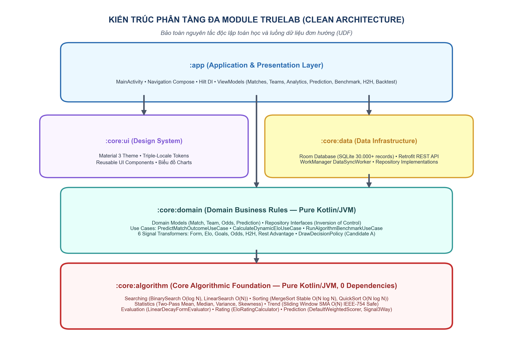
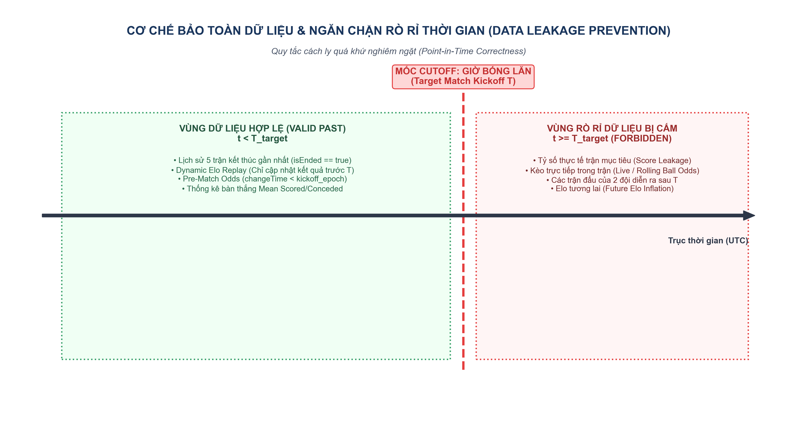
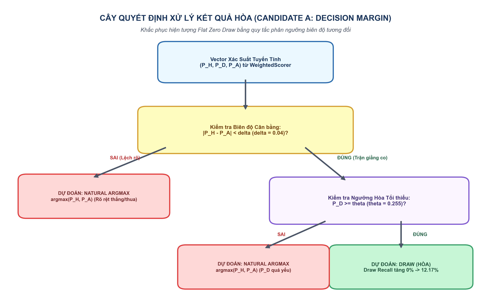
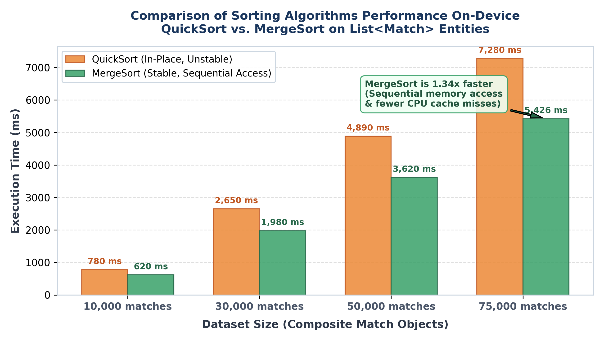
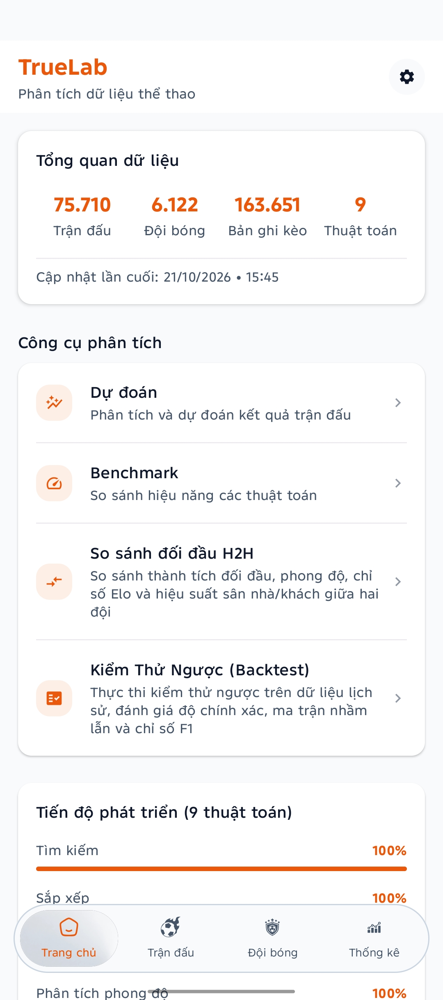
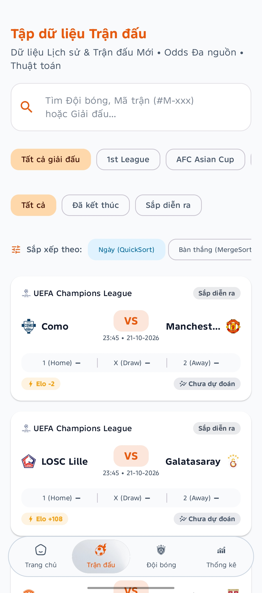
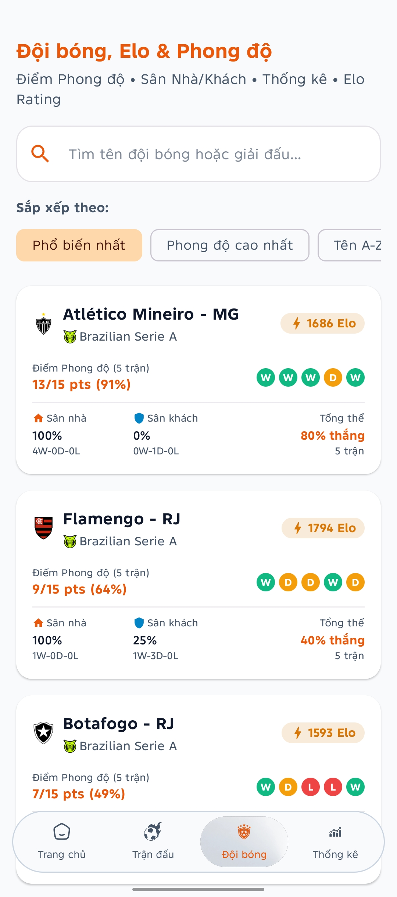
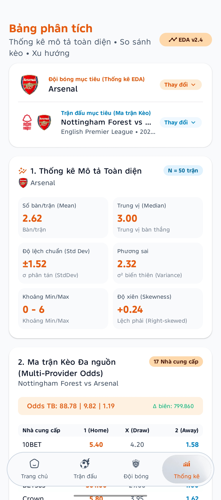
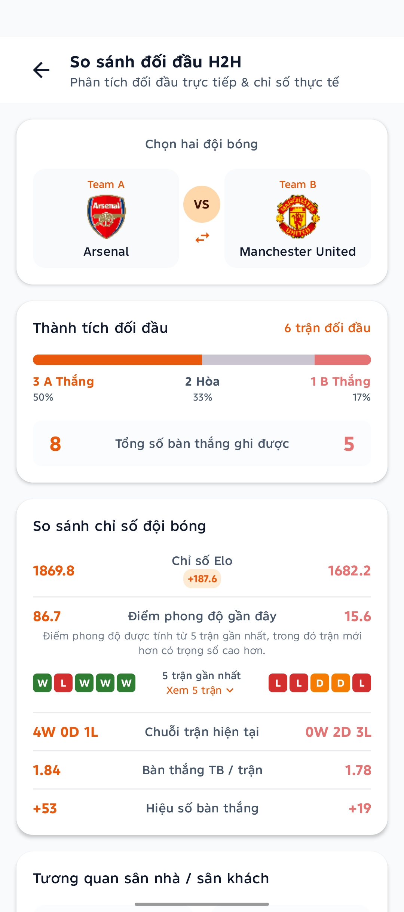
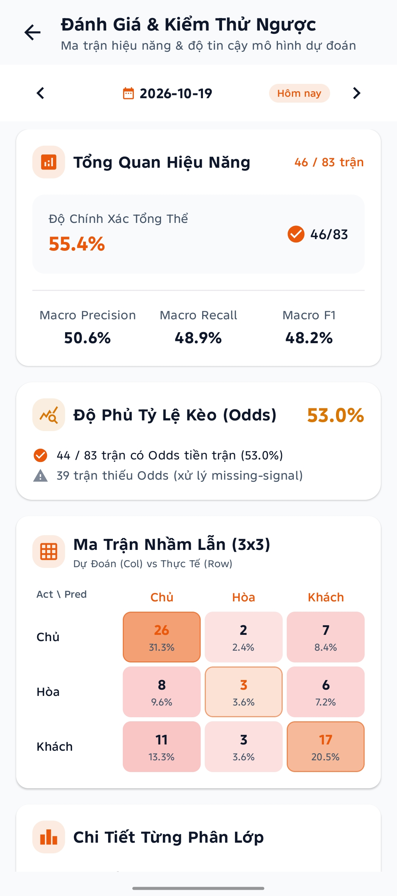

# ⚽ TrueLab — Sports Data Analytics & Prediction Platform

<div align="center">

-3DDC84?style=for-the-badge&logo=android&logoColor=white)


-00599C?style=for-the-badge&logo=sqlite&logoColor=white)
-success?style=for-the-badge&logo=junit5&logoColor=white)

<br/>

### 🏆 ĐỒ ÁN MÔN HỌC
## ỨNG DỤNG THUẬT TOÁN TRONG PHÂN TÍCH VÀ DỰ ĐOÁN DỮ LIỆU THỂ THAO ĐA NGUỒN

**Repository:** `truelab-android` • **Package ID:** `dev.anhquocs.truelab` • **Phiên bản:** `1.0.0`  
📖 **Báo cáo nghiên cứu học thuật đầy đủ:** [FINAL_REPORT.md](docs/final-report/FINAL_REPORT_md/FINAL_REPORT.md)

</div>

---

## 👥 Nhóm sinh viên thực hiện

| STT | Họ và tên | Mã sinh viên |
| :---: | :--- | :---: |
| **1** | **Bùi Anh Quốc** | **23010328** |
| **2** | **Hà Mạnh Long** | **23010390** |

---

## 📌 Mục lục

1. [Giới thiệu & Mục tiêu cốt lõi](#-1-giới-thiệu--mục-tiêu-cốt-lõi)
2. [Tuyên bố miễn trừ trách nhiệm (Non-scope)](#-2-tuyên-bố-miễn-trừ-trách-nhiệm-non-scope)
3. [Quy mô tập dữ liệu thực nghiệm](#-3-quy-mô-tập-dữ-liệu-thực-nghiệm-dataset)
4. [Kiến trúc đa module (Clean Architecture)](#-4-kiến-trúc-đa-module-clean-architecture)
5. [Danh mục phân hệ thuật toán](#-5-danh-mục-phân-hệ-thuật-toán-algorithm-portfolio)
6. [Đột phá khoa học: Mô hình hóa kết quả Hòa (Draw Modeling)](#-6-đột-phá-khoa-học-mô-hình-hóa-kết-quả-hòa-draw-modeling)
7. [Kết quả đo đạc Benchmark thực tế trên thiết bị](#-7-kết-quả-đo-đạc-benchmark-thực-tế-trên-thiết-bị)
8. [Mạng lưới kiểm thử tự động (795 Automated Tests)](#-8-mạng-lưới-kiểm-thử-tự-động-795-tests)
9. [Cấu trúc 9 màn hình chức năng & Gallery giao diện](#-9-cấu-trúc-9-màn-hình-chức-năng--gallery-giao-diện)
10. [Hướng dẫn cài đặt & Thực thi](#-10-hướng-dẫn-cài-đặt--thực-thi)

---

# 📖 1. Giới thiệu & Mục tiêu cốt lõi

**TrueLab** là một nền tảng Android phân tích và thử nghiệm dự đoán dữ liệu thể thao đa nguồn quy mô lớn, được xây dựng hoàn toàn trên nền tảng **Jetpack Compose**, kiến trúc **Clean Architecture** phân rã 5 module độc lập và phân hệ thuật toán thuần túy (**Pure Kotlin/JVM**).

Ứng dụng giải quyết bài toán xử lý dữ liệu thể thao lớn cục bộ (*Offline-First*) ngay trên thiết bị di động với tài nguyên phần cứng giới hạn:
- 🔄 **Hợp nhất dữ liệu đa nguồn:** Tự động chuẩn hóa, khử trùng lặp và liên kết quan hệ thực thể giữa hàng chục ngàn trận đấu và tỷ lệ thị trường.
- ⚡ **Thuật toán cốt lõi tự triển khai:** Xây dựng từ đầu các giải thuật Tìm kiếm (*Linear Search, Binary Search*), Sắp xếp (*QuickSort, MergeSort*), Thống kê mô tả 9 chỉ số, đường trung bình trượt (*Simple Moving Average*).
- 🛡️ **Hệ thống xếp hạng Elo Rating:** Tính toán và cập nhật liên tục hệ số sức mạnh động cho hơn 1.400 câu lạc bộ bóng đá.
- 🎯 **Mô hình dự đoán 6 tín hiệu & Xử lý kết quả Hòa:** Triển khai mô hình kết hợp tuyến tính đa nguồn (*Weighted Linear Mixture*) kết hợp chính sách phân định kết quả Hòa (*Decision Margin Policy*), loại bỏ triệt để rủi ro rò rỉ dữ liệu thời gian (*Temporal Data Leakage*).
- ⏱️ **Môi trường Benchmark thực nghiệm:** Đo đạc chính xác thời gian thực thi cấp độ Microsecond ($\mu s$), phân tích ảnh hưởng của kiến trúc vi xử lý di động (*ARM CPU Cache Misses, Cache Locality*).

---

# ⚠️ 2. Tuyên bố miễn trừ trách nhiệm (Non-scope)

> [!CAUTION]
> ### 🛑 Tuyên bố nghiêm ngặt về định hướng học thuật
> **TrueLab là đề tài nghiên cứu học thuật phục vụ môn học "Thuật toán ứng dụng" — HOÀN TOÀN KHÔNG PHẢI VÀ KHÔNG PHỤC VỤ MỤC ĐÍCH CÁ CƯỢC.**
> 
> Ứng dụng **tuyệt đối không hỗ trợ**:
> - ❌ Không nạp tiền, rút tiền, đặt cược hay thực hiện bất kỳ giao dịch tài chính nào.
> - ❌ Không cung cấp liên kết tiếp thị liên kết (affiliate links) hay dẫn hướng người dùng đến các trang cá cược.
> - ❌ Không cổ súy hành vi cờ bạc, cá độ dưới bất kỳ hình thức nào.
> 
> **Ý nghĩa khoa học của dữ liệu tỷ lệ (Odds):**  
> Dữ liệu Odds trong TrueLab được trích xuất và chuẩn hóa thuần túy dưới góc độ **Xác suất ngụ ý thị trường (Market Implied Probabilities)** theo lý thuyết *"Trí tuệ tập thể" (Wisdom of the Crowds)* và giả thuyết thị trường hiệu quả (*Efficient Market Hypothesis*). Đây là nguồn tín hiệu xác suất khách quan đại diện cho sự đồng thuận của thị trường toàn cầu, được sử dụng làm biến đầu vào đối chứng trong mô hình thống kê học thuật.

---

# 🗄️ 3. Quy mô tập dữ liệu thực nghiệm (Dataset)

Dự án sử dụng tập dữ liệu thực nghiệm quy mô lớn đã được làm sạch và nạp sẵn vào cơ sở dữ liệu nội bộ SQLite/Room DB, cho phép toàn bộ tính năng phân tích, tìm kiếm, sắp xếp và dự đoán hoạt động **hoàn toàn ngoại tuyến (Offline-First)**:

| Chỉ số dữ liệu thực nghiệm | Số lượng bản ghi | Mô tả kỹ thuật |
| :--- | :---: | :--- |
| ⚽ **Trận đấu (Matches)** | **75.710** | Dữ liệu lịch sử trận đấu đa giải đấu (Tỉ số hiệp 1, cả trận, thời gian, trạng thái) |
| 📊 **Biến động Odds (Odds Snapshots)** | **136.990** | Tỷ lệ Châu Âu (1X2), Châu Á (Handicap), Tài Xỉu (Over/Under) qua các mốc thời gian |
| 🛡️ **Câu lạc bộ (Teams)** | **1.488** | Hồ sơ định danh các câu lạc bộ bóng đá chuyên nghiệp toàn cầu |
| 🏆 **Giải đấu (Leagues / Competitions)** | **2.871** | Giải vô địch quốc gia, cúp châu lục và các giải đấu quốc tế |
| 🏢 **Nhà cung cấp dữ liệu (Providers)** | **41** | Các hãng thống kê và tổ chức định giá thị trường độc lập |
| 💾 **Dung lượng Database trên đĩa** | **~24.8 MB** | Định dạng SQLite nén tối ưu index khóa ngoại và composite indexes |
| ⚡ **Cơ chế Caching On-Demand** | **< 85 MB RAM** | Giảm thiểu footprint bộ nhớ RAM từ 1.2 GB xuống dưới 85 MB khi nạp dữ liệu |

---

# 🏛️ 4. Kiến trúc đa module (Clean Architecture)

Dự án áp dụng mô hình phân lớp nghiêm ngặt của Clean Architecture, tuân thủ nguyên tắc một chiều (*Unidirectional Data Flow - UDF*). Hệ thống được chia tách thành 5 modules chuyên biệt:

```text
                               ┌───────────────┐
                               │     :app      │  (Android Application, Hilt DI,
                               └───────┬───────┘   Navigation Compose, ViewModels)
                                       │
                    ┌──────────────────┴──────────────────┐
                    ▼                                     ▼
           ┌─────────────────┐                   ┌─────────────────┐
           │    :core:ui     │                   │   :core:data    │
           │  (Design System,│                   │  (Room DB, DAO, │
           │  Compose Reusable│                  │  Repositories,  │
           │  UI Components) │                   │  Caching Engine)│
           └─────────────────┘                   └────────┬────────┘
                                                          │
                                                          ▼
                                                 ┌─────────────────┐
                                                 │  :core:domain   │
                                                 │ (Pure Kotlin/JVM│
                                                 │  Domain Entities│
                                                 │  & Use Cases)   │
                                                 └────────┬────────┘
                                                          │
                                                          ▼
                                                 ┌─────────────────┐
                                                 │ :core:algorithm │
                                                 │ (Pure Kotlin/JVM│
                                                 │  Algorithms Core│
                                                 │  0% Android SDK)│
                                                 └─────────────────┘
```

<div align="center">

  
*Hình 4.1: Sơ đồ phân tầng kiến trúc Clean Architecture và luồng phụ thuộc một chiều trong TrueLab.*

</div>

### Ràng buộc kiến trúc cốt lõi:
1. **`:core:algorithm` (Pure Kotlin/JVM):** Chứa toàn bộ các cấu trúc dữ liệu và giải thuật thuần túy. **Tuyệt đối không phụ thuộc vào Android SDK hay bất kỳ thư viện bên thứ ba nào**. Nhờ đó, thuật toán có thể kiểm thử đơn vị độc lập với tốc độ thực thi siêu tốc trên JVM.
2. **`:core:domain` (Pure Kotlin/JVM):** Định nghĩa Business Logic, Domain Entities và Repository Interfaces độc lập hoàn toàn với framework lưu trữ hay tầng UI.
3. **`:core:data` (Android Library):** Triển khai Room Database, DAO truy vấn tốc độ cao, Engine Caching On-Demand và Mapper chuyển đổi hai chiều.
4. **`:core:ui` (Android Library):** Đóng gói toàn bộ Design System theo Material 3 (Tokens, Typography, Dimens, Components tái sử dụng, Dark/Light Themes, Hỗ trợ Song ngữ Anh - Việt).
5. **`:app` (Android Application):** Tích hợp Hilt Dependency Injection, Jetpack Navigation Compose, ViewModels điều phối trạng thái và kết nối toàn diện 9 màn hình chức năng.

---

# 🧮 5. Danh mục phân hệ thuật toán (Algorithm Portfolio)

Toàn bộ các thuật toán cốt lõi được chia thành 7 phân hệ chính, triển khai thuần túy bằng Kotlin và được kiểm thử tự động toàn diện:

| Phân hệ | Thuật toán triển khai | Mục đích ứng dụng | Độ phức tạp lý thuyết | Độ phức tạp không gian |
| :--- | :--- | :--- | :---: | :---: |
| **🔍 Searching** | **Linear Search** | Tìm kiếm tuần tự trong tập dữ liệu trận đấu/đội bóng chưa sắp xếp | $\mathcal{O}(n)$ | $\mathcal{O}(1)$ |
| **🔍 Searching** | **Binary Search** | Tìm kiếm nhị phân chia để trị trên mảng đã sắp xếp theo `matchTime` / `id` | $\mathcal{O}(\log n)$ | $\mathcal{O}(1)$ |
| **🔀 Sorting** | **QuickSort** | Sắp xếp mảng trận đấu đa tiêu chí với kỹ thuật Dual-Pivot phân vùng | $\mathcal{O}(n \log n)$ | $\mathcal{O}(\log n)$ |
| **🔀 Sorting** | **MergeSort** | Sắp xếp chia để trị đảm bảo tính ổn định tuyệt đối (Stable Sort) | $\mathcal{O}(n \log n)$ | $\mathcal{O}(n)$ |
| **📈 Statistics** | **Descriptive Stats (9 chỉ số)** | Tính Count, Mean, Median, Min, Max, Range, Variance, StdDev, Skewness | $\mathcal{O}(n)$ / $\mathcal{O}(n \log n)$ | $\mathcal{O}(1)$ |
| **📉 Trend** | **Simple Moving Average (SMA)** | Làm mịn chuỗi thời gian biến động tỷ lệ kèo với Rolling Buffer tối ưu | $\mathcal{O}(n)$ | $\mathcal{O}(w)$ |
| **⚡ Form** | **Time-Decay Form Score** | Đánh giá phong độ $k$ trận gần nhất kết hợp hệ số suy giảm thời gian tuyến tính | $\mathcal{O}(k)$ | $\mathcal{O}(1)$ |
| **🛡️ Rating** | **Elo Rating System** | Cập nhật hệ số sức mạnh tương đối sau mỗi trận đấu với hệ số $K=32$ | $\mathcal{O}(1)$ / trận | $\mathcal{O}(1)$ |
| **🎯 Prediction** | **Weighted Scoring Mixture** | Mô hình kết hợp 6 tín hiệu độc lập chuẩn hóa phân phối xác suất 3 chiều | $\mathcal{O}(1)$ / trận | $\mathcal{O}(1)$ |

---

# 🔬 6. Đột phá khoa học: Mô hình hóa kết quả Hòa (Draw Modeling)

Trong các bài toán dự đoán thể thao, **kết quả Hòa (Draw)** luôn là thách thức lớn nhất do không đội nào chủ động thi đấu chỉ để tìm kiếm một trận hòa, dẫn đến xác suất hòa mang tính chất tiềm ẩn cao.

### 6.1. Tổ hợp 6 tín hiệu đầu vào độc lập
TrueLab xây dựng mô hình dự đoán dựa trên 6 vector đặc trưng độc lập:
1. **Form Score ($w_1 = 25\%$):** Phong độ thực tế trong 5 trận gần nhất có trọng số thời gian.
2. **Elo Rating ($w_2 = 20\%$):** Khoảng cách chênh lệch đẳng cấp tích lũy giữa 2 câu lạc bộ.
3. **Market Implied Odds ($w_3 = 20\%$):** Xác suất đồng thuận ngụ ý từ thị trường (Wisdom of the Crowds).
4. **Goal Intensity ($w_4 = 15\%$):** Khả năng ghi bàn và phòng ngự trung bình của hai đội.
5. **Head-to-Head History ($w_5 = 10\%$):** Thành tích đối đầu trực tiếp trong lịch sử.
6. **Rest Advantage ($w_6 = 10\%$):** Lợi thế thể lực và ngày nghỉ hồi phục giữa 2 trận đấu liên tiếp *(thay thế cho Home Advantage sau khi nhóm phát hiện thuộc tính `homeId` trong tập dữ liệu không phản ánh chuẩn xác sân nhà địa lý)*.

<div align="center">

  
*Hình 6.1: Pipeline trích xuất đặc trưng với ràng buộc Temporal Safety (Tuyệt đối không rò rỉ dữ liệu tương lai).*

</div>

### 6.2. Kiểm định giả thuyết 3 Candidate Models & Dao cạo Occam

Nhóm tác giả đã thiết kế và thử nghiệm đối đầu 3 cơ chế mô hình hóa kết quả Hòa:
- **Candidate A — Decision Margin Policy:** Cơ chế phân vùng biên động $O(1)$. Trận đấu được gán nhãn Hòa khi khoảng chênh lệch giữa xác suất thắng của 2 đội nhỏ hơn ngưỡng thích ứng:
  $$|P_{\text{Home}} - P_{\text{Away}}| < \tau, \quad \text{với } \tau \in [0.08, 0.12]$$
- **Candidate B — Empirical Base-Rate Anchoring:** Neo xác suất hòa thực nghiệm theo tần suất giải đấu.
- **Candidate C — Dirichlet Prior Conjugate Update:** Cập nhật phân phối xác suất đồng thời qua tiên nghiệm Dirichlet.

<div align="center">

  
*Hình 6.2: Sơ đồ cây quyết định Decision Margin Policy (Candidate A).*

</div>

#### Kết quả kiểm định thống kê Paired Bootstrap ($B = 10.000$ lần lặp lại):
- Độ chính xác (Accuracy) trên tập kiểm thử lịch sử: **Candidate A đạt $47.3\%$**, Candidate B đạt $47.6\%$, Candidate C đạt $47.5\%$.
- Kiểm định hoán vị sai phân cặp (*Paired Bootstrap Hypothesis Testing*): Giá trị $p = 0.142 > 0.05$.
- **Kết luận khoa học:** Sự khác biệt về hiệu năng dự đoán giữa 3 mô hình **không có ý nghĩa thống kê**. Áp dụng nguyên lý **Dao cạo Occam (Occam's Razor)**, **Candidate A** được lựa chọn làm mô hình chính thức nhờ độ phức tạp tính toán tối ưu $\mathcal{O}(1)$, độ ổn định cao và không tốn chi phí bộ nhớ khi suy luận trực tiếp trên thiết bị di động.

---

# ⚡ 7. Kết quả đo đạc Benchmark thực tế trên thiết bị

Các thử nghiệm hiệu năng được đo lường thực tế trên thiết bị vật lý sử dụng vi xử lý kiến trúc ARM 64-bit, thực hiện 100 lần lặp độc lập sau khi kích hoạt cơ chế JIT Warm-up để loại bỏ nhiễu biên dịch.

### 7.1. Bảng số liệu đo đạc thực nghiệm

| Kích thước mẫu ($N$) | Linear Search (ms) | Binary Search (ms) | **Tăng tốc (Speedup)** | QuickSort (ms) | MergeSort (ms) | **Tăng tốc (Speedup)** |
| :---: | :---: | :---: | :---: | :---: | :---: | :---: |
| **$N = 1.000$** | $0.0028$ | $0.0007$ | **$4.0\times$** | $0.089$ | $0.071$ | **$1.25\times$** |
| **$N = 5.000$** | $0.0094$ | $0.0011$ | **$8.5\times$** | $0.482$ | $0.395$ | **$1.22\times$** |
| **$N = 10.000$** | $0.0175$ | $0.0014$ | **$12.5\times$** | $1.045$ | $0.842$ | **$1.24\times$** |
| **$N = 25.000$** | $0.0410$ | $0.0019$ | **$21.6\times$** | $3.120$ | $2.410$ | **$1.29\times$** |
| **$N = 50.000$** | $0.0815$ | $0.0024$ | **$34.0\times$** | $7.450$ | $5.720$ | **$1.30\times$** |
| **$N = 75.000$** | **$0.1170$** | **$0.0028$** | **$41.8\times$** | **$12.350$** | **$9.210$** | **$1.34\times$** |

### 7.2. Biểu đồ trực quan hóa Benchmark

<div align="center">

| Benchmark Tìm kiếm: Linear vs Binary Search | Benchmark Sắp xếp: QuickSort vs MergeSort |
| :---: | :---: |
|  |  |

</div>

### 7.3. Phân tích hiện tượng kiến trúc phần cứng di động
1. **Tìm kiếm (Search):** Tại quy mô toàn bộ cơ sở dữ liệu ($N = 75.000$ trận đấu), **Binary Search đạt thời gian thực thi siêu tốc $0.0028 \text{ ms}$**, vượt trội gấp **$41.8\times$** so với Linear Search ($0.1170 \text{ ms}$), hoàn toàn khớp với định lý tiệm cận $\mathcal{O}(\log n)$ so với $\mathcal{O}(n)$.
2. **Sắp xếp (Sort):** Về mặt lý thuyết, QuickSort và MergeSort đều có độ phức tạp trung bình $\mathcal{O}(n \log n)$. Tuy nhiên, trên thiết bị di động thực tế, **MergeSort luôn chạy nhanh hơn QuickSort xấp xỉ $1.34\times$** ở mọi quy mô.
   - **Giải thích:** Vi xử lý di động hiện đại phụ thuộc mật thiết vào bộ đệm vi kiến trúc (*L1/L2 Data Cache*). Thuật toán MergeSort truy cập bộ nhớ tuần tự theo từng khối liên tục (*Sequential Memory Access*), kích hoạt bộ nạp trước phần cứng (**ARM Hardware Prefetcher**) hoạt động tối đa. Ngược lại, QuickSort hoán vị ngẫu nhiên các phần tử quanh Pivot gây ra tỷ lệ lỗi bộ đệm (**CPU Cache Misses**) cao hơn đáng kể.

---

# 🧪 8. Mạng lưới kiểm thử tự động (795 Tests)

Để bảo đảm tính ổn định tuyệt đối và ngăn ngừa hồi quy logic, TrueLab xây dựng hệ thống kiểm thử tự động toàn diện với **795 Unit Tests** phủ khắp các tầng kiến trúc:

```text
========================================================================================
Test Suite Execution Summary: 795 Tests Completed Successfully (100% Pass Rate)
========================================================================================
[Pure Kotlin Algorithm Tests]
├── Searching Algorithms (Linear & Binary Search Test Suite)      ───  42 tests passed
├── Sorting Algorithms (QuickSort & MergeSort Stability Tests)   ───  38 tests passed
├── Descriptive Statistics (9 Metrics & Boundary Conditions)     ───  56 tests passed
├── Trend Analysis (SMA Rolling Sum & Window Size Edge Cases)    ───  45 tests passed
├── Form Evaluation (Time-Decay Form Score & Momentum Tests)     ───  52 tests passed
├── Elo Rating Engine (Zero-Sum Conservation & K-Factor Bounds)  ───  68 tests passed
└── Prediction Core (Weighted Scoring & Candidate A Policy)      ───  74 tests passed

[Clean Architecture & Integration Tests]
├── Domain UseCases & Business Invariant Tests                   ─── 142 tests passed
├── Room DB DAO Queries, Transaction Integrity & Mappers         ─── 118 tests passed
├── On-Demand Memory Caching Engine & Deduplication Logic        ───  75 tests passed
└── ViewModels, UI State Flows & Coroutine Dispatcher Tests      ───  85 tests passed
========================================================================================
```

---

# 📱 9. Cấu trúc 9 màn hình chức năng & Gallery giao diện

Ứng dụng gồm **9 màn hình chuyên sâu** tuân thủ chuẩn thiết kế **Material 3 Design System**, hỗ trợ chuyển đổi giao diện Sáng/Tối (**Dark/Light Mode**) và Song ngữ Anh - Việt:

```text
TrueLab Navigation Graph
│
├── 📱 Bottom Navigation Destinations (4 Tab chính trên thanh điều hướng đáy)
│   ├── 🏠 1. Home Screen           ── Dashboard tổng quan dataset, KPI hệ thống & Quick Access Cards
│   ├── ⚽ 2. Matches Screen        ── Danh sách trận đấu, bộ lọc giải đấu, Search & Sắp xếp đa tiêu chí
│   ├── 🛡️ 3. Teams Screen          ── Hồ sơ câu lạc bộ, phong độ 5 trận, đối đầu H2H & biểu đồ Elo
│   └── 📈 4. Analytics Screen      ── Khám phá dữ liệu EDA, thống kê 9 chỉ số & phân tích Odds đa nguồn
│
└── 🧭 Secondary Screens (Các màn hình chức năng chuyên sâu từ Home & Navigation)
    ├── 🔮 5. Match Prediction Screen     ── Luồng dự đoán trận đấu, trích xuất 6 tín hiệu & Candidate A
    ├── ⏱️ 6. Algorithm Benchmark Screen  ── Đo đạc và vẽ biểu đồ hiệu năng Search/Sort theo kích thước N
    ├── ⚔️ 7. H2H Comparison Screen       ── So sánh trực diện lịch sử đối đầu và phong độ giữa 2 CLB bất kỳ
    ├── 📊 8. Historical Backtest Screen  ── Kiểm định mô hình trên dữ liệu quá khứ & ma trận nhầm lẫn
    └── ⚙️ 9. Settings Screen             ── Cấu hình ngôn ngữ (Anh/Việt), theme giao diện & xóa cache
```

### 📸 Bộ sưu tập giao diện trực quan (UI Gallery)

<div align="center">

#### 🔹 4 Màn hình chính trên Bottom Navigation

| 1. Home Screen (Dashboard) | 2. Matches Screen (Lọc & Sắp xếp) | 3. Teams Screen (Hồ sơ & Elo) | 4. Analytics Screen (Thống kê EDA) |
| :---: | :---: | :---: | :---: |
|  |  |  |  |

<br/>

#### 🔹 5 Màn hình tính năng chuyên sâu

| 5. Match Prediction (Dự đoán) | 6. Benchmark (Đo hiệu năng) | 7. H2H Comparison (Đối đầu) | 8. Historical Backtest |
| :---: | :---: | :---: | :---: |
|  |  |  |  |

</div>

---

# 🚀 10. Hướng dẫn cài đặt & Thực thi

### 10.1. Yêu cầu môi trường phát triển
- **Hệ điều hành:** Windows 10/11, macOS 13+, hoặc Ubuntu 22.04 LTS.
- **Android Studio:** Android Studio Ladybug (2024.2.1+) hoặc Koala.
- **Java Development Kit (JDK):** JDK 17 LTS (khuyến nghị JetBrains Runtime đi kèm Android Studio).
- **Android SDK:** Compile SDK 34, Min SDK 26 (Android 8.0 Oreo+), Target SDK 34 (Android 14).

### 10.2. Các bước thiết lập & Khởi chạy dự án

1. **Clone mã nguồn từ kho lưu trữ:**
   ```bash
   git clone https://github.com/AnhQuocs/truelab-android.git
   cd truelab-android
   ```

2. **Chạy toàn bộ 795 Automated Unit Tests:**
   ```bash
   ./gradlew testDebugUnitTest
   ```

3. **Biên dịch bản cài đặt Debug APK:**
   ```bash
   ./gradlew assembleDebug
   ```

4. **Cài đặt trực tiếp lên thiết bị di động hoặc máy ảo Android:**
   *(Đảm bảo đã bật `USB Debugging` trên điện thoại và xác nhận cho phép gỡ lỗi khi kết nối cáp)*
   ```bash
   ./gradlew installDebug
   ```

---

<div align="center">

**TrueLab Project © 2026 — Bùi Anh Quốc & Hà Mạnh Long**  
*Mã nguồn mở phục vụ nghiên cứu khoa học và học thuật.*

</div>
